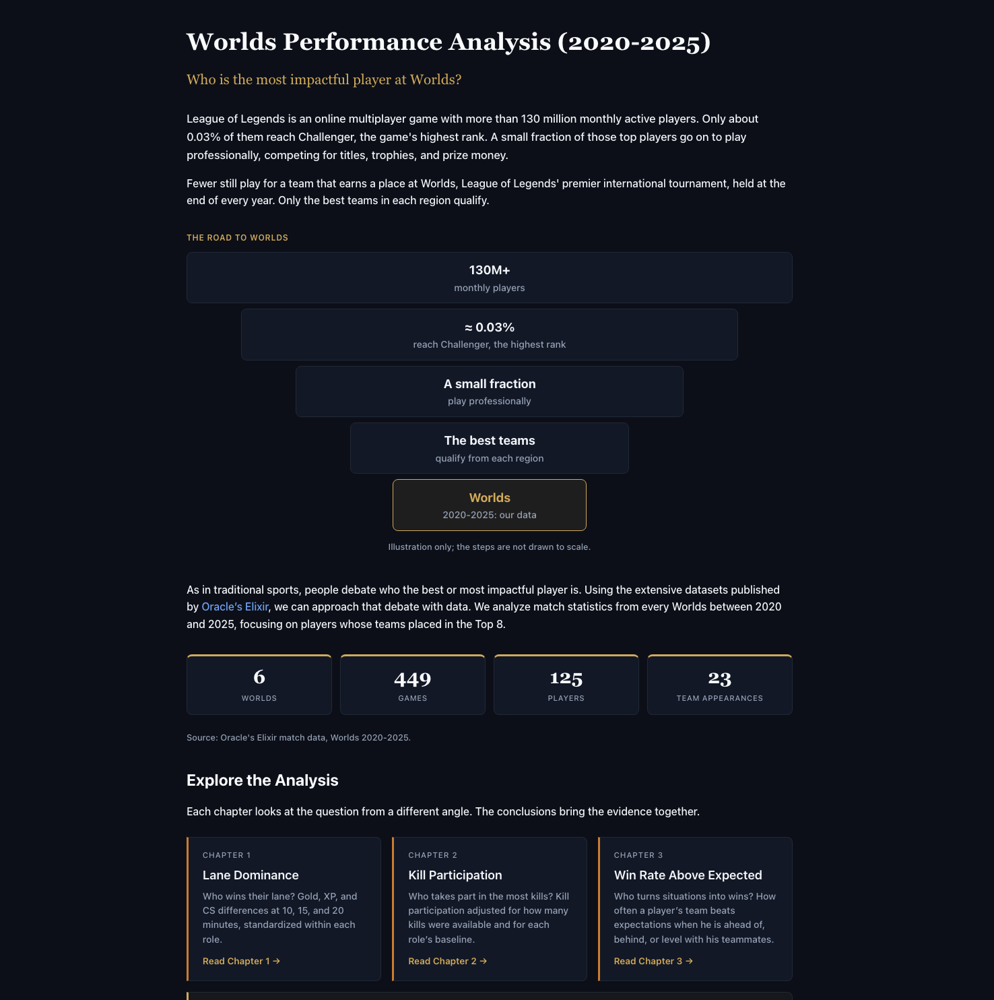

# Who Is the Most Impactful Player at Worlds?

**Live site: https://isaaclustre.github.io/lol-worlds-analysis/**

  <!-- screenshot of your home page; save it in an assets/ folder -->

A data analysis of every League of Legends World Championship from 2020 to 2025, built using PostgreSQL, Python, and HTML/CSS. It asks who the most impactful player is by combining three measures: lane dominance, kill participation, and win rate above expected given the game situation.

## Key findings

- **Chovy** is a lane-first player: 2nd in lane dominance, but 110th of 127 in kill participation. He converts the leads from his laning phase into wins consistently (+6.9 points above expected, 10th on the carry list).
- **Zeus** has the strongest overall case on the statistics alone: 10th in lane dominance, 4th in kill participation, and 3rd on the carry list (+8.2 points over 15 games).
- **The measures cannot separate teammates who shared games.** Several T1 players appear at the top of multiple lists, so individual impact is hard to distinguish from team strength. The conclusions page covers this limit.
- **The data does not tell the full story.** There are intangible valuables that the data is unable to capture, such as shotcalling, playmaking, and drafting. The conclusion page also covers this limit. 


## Approach

| Chapter | Question | Method |
|---|---|---|
| 1. Lane dominance | Who wins their lane? | Individual Gold, CS, and XP differences at 10, 15, and 20 minutes, standardized within their respective role; ranked by an equal-weight and a PCA-weight mean index. |
| 2. Kill participation | Who takes part in the most kills? | Pool kills and assists over team kills, shrink toward the role average with a beta-binomial prior, then standardize within role. |
| 3. Win rate above expected | Who turns their game states into wins? | Label each individual's game as lead, even, or deficit (±0.4 role standard deviations of gold difference at 15 minutes), compare each player with everyone else at their position in the same situation, and shrink the result. |

For chapter 3, games are grouped as **carry** (the player is ahead of their teammates), **carried** (they are behind them), and **aligned** (both are in the same state).

Shrinkage matters throughout. A rate from a few games is noisy, so each estimate is pulled toward a baseline in proportion to how little evidence it rests on:

$$\widehat{\text{rate}}_i = \frac{N_i}{N_i + k_i}\,\text{rate}_i$$

## Repository layout

```
sql/        numbered scripts that build every view (run in order)
python/     notebook and the scripts that calculated PCA-weighted means and fit the shrinkage parameters
params/     fitted parameters (kappa for kill participation, tau^2 for win rate above expected)
queries/    the query behind each table and figure on the site
docs/       the website (served by GitHub Pages)
data/       instructions for getting the raw data
```

## Reproducing the analysis

**Requirements:** PostgreSQL [18], Python [3.x], and the packages in `requirements.txt`.

1. **Get the data.** Download the 2020–2025 match data from the Google Drive provided by [Oracle's Elixir](https://oracleselixir.com/tools/downloads) (see `data/README.md`). The raw files are not included in this repo.
2. **Create the database.**
```bash
   createdb lol_worlds
   export DATABASE_URL=postgresql://localhost/lol_worlds
   pip install -r requirements.txt
```
3. **Load the data and build the base views.**
```bash
   psql lol_worlds -f sql/00_load_data.sql
   psql lol_worlds -f sql/01_base_views.sql
```
4. **Chapter 1.** `psql lol_worlds -f sql/02_lane_dominance.sql`, then run `python/[lane_indices.ipynb]`.
5. **Chapter 2.** Run the first part of `sql/03_kill_participation.sql`, then `python/[fit_kp_parameters.py]` to fit the shrinkage strengths, and load `params/kp_params.csv`. Then run the second part of the script.
6. **Chapter 3.** Run the first part of `sql/04_win_rate_above_expected.sql`, then `python/[fit_wae_tau.py]` to fit the variance parameters, and load `params/wae_params.csv`. Then run the second part.
7. **Check the results.** `psql lol_worlds -f sql/05_checks.sql`.

The materialized views are snapshots. If you change upstream data or a parameter, refresh them in order:

```sql
REFRESH MATERIALIZED VIEW wins_above_expected_view;
REFRESH MATERIALIZED VIEW player_wae_off_diagonals;
```

## Design decisions and limitations

- **Worlds games only.** Worlds Qualifier matches tagged as 'WLDs' are excluded with a date window (Sept 23 to Dec 1 of each year).
- **Swap games removed.** Games where the support takes the bot lane's CS (such as the "fasting Senna" strategy) are removed, because they distort lane statistics.
- **Gold difference at 15 minutes** defines the game state. Experience difference was considered, but was deemed too variable and not as consistent as gold difference.
- **Small samples.** Many players have few games in each situation. Shrinkage reduces the noise but does not remove it.
- **Team effect.** Players who shared nearly all their games receive nearly the same credit, so these measures cannot separate individual impact from team strength.
- **Not covered:** drafting, shot-calling, clutch-factor, and play-making are not in the data.

## Tech

PostgreSQL, SQL (window functions, materialized views), Python (pandas, NumPy, SciPy), HTML/CSS, MathJax.

## Data and license

Match data is from [Oracle's Elixir](https://oracleselixir.com/). Please check their terms before reusing it. Code is released under the [MIT License](LICENSE).

## Author

[Isaac Lustre], [Applied & Computational Mathematics, USC '26] · [www.linkedin.com/in/isaac-lustre-548a71318] · [isaaclustre4@gmail.com]
